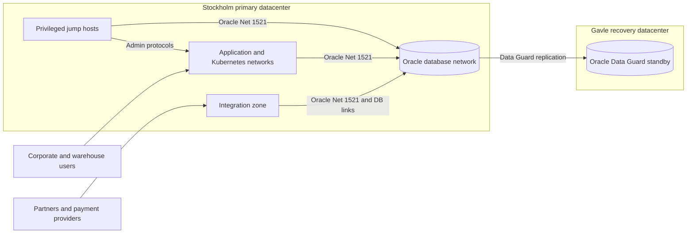
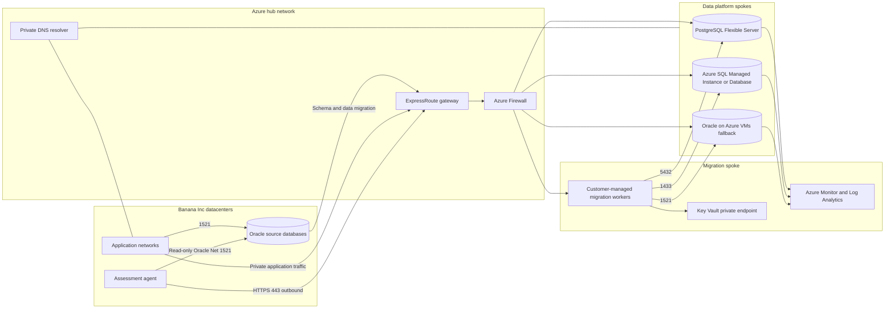

# Banana Inc Network Topology

The diagrams are proposed discovery artifacts, not deployed Azure architecture.

## Current topology

Current-state questions:

- Which flows cross security zones, and which are hidden inside database links?
- Are application connection strings centralized and rotation-ready?
- What bandwidth, latency and packet-loss baselines apply between datacenters?
- Which partner IP allowlists or certificates would change at cutover?
- Is DNS failover used consistently, or do applications pin host names or IP addresses?

## Proposed assessment and target topology

## Connectivity requirements

| Source | Destination | Port/protocol | Purpose | Default control |
| --- | --- | --- | --- | --- |
| Assessment agent | Toolkit API | HTTPS 443 outbound | Heartbeat, jobs and metadata results | TLS, HMAC agent identity, egress allowlist |
| Application networks | Oracle source | TCP 1521 | Current application traffic | Existing segmentation; document every client |
| Migration workers | Oracle source | TCP 1521 | Schema extract, initial load and CDC | Time-bound NSG/firewall rule and dedicated account |
| Migration workers/applications | PostgreSQL target | TCP 5432 | Test, load and target traffic | Private routing, TLS and least privilege |
| Migration workers/applications | SQL target | TCP 1433 | Test, load and target traffic | Private endpoint/subnet controls and TLS |
| Applications | Oracle VM fallback | TCP 1521 | Rehosted Oracle traffic | Private subnet, NSG and Oracle native encryption |
| Azure resources | Key Vault/monitoring | HTTPS 443 | Secrets, metrics and logs | Managed identity and private endpoints where required |

## Design rules

- No database or migration endpoint is exposed to the public internet.
- Route on-premises traffic through the hub firewall and log allowed/denied flows.
- Separate migration workers from steady-state application and database subnets.
- Use private DNS names and lower TTLs before migration; do not embed target IPs.
- Size ExpressRoute from measured initial-load volume, change rate and cutover window.
- Validate asymmetric routing, MTU, TLS inspection and idle timeouts before CDC testing.
- Keep production and non-production subscriptions, networks and credentials separated.