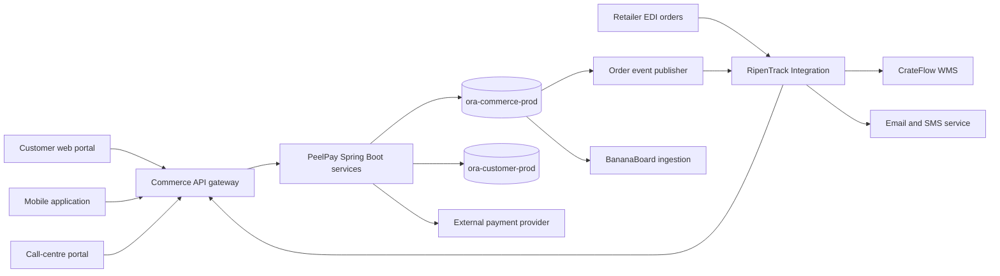

# PeelPay Commerce Application Dossier

All names, roles, volumes, service levels and technical details in this document are fictional discovery assumptions. They describe the application represented by the runnable Banana Commerce Oracle sample and require validation during assessment.

## Business context

PeelPay Commerce is Banana Inc's business-to-business ordering platform for retailers, restaurants and catering companies in Northern Europe. Customers use it to browse products, receive contract pricing, place replenishment orders and track fulfilment. Internal call-centre staff can place orders on a customer's behalf, and larger retailers submit orders through EDI.

The platform is operated by the Digital Commerce team. Warehouse fulfilment is owned by the Warehouse Technology team, customer master data by the Customer Platform team and partner exchange by Integration Services.

| Attribute | Fictional value |
| --- | --- |
| Business owner | Director of Digital Commerce |
| Technical owner | Digital Commerce Engineering |
| Primary users | Retail buyers, restaurant managers and call-centre agents |
| Operating hours | 24x7, with staffed support 06:00-22:00 CET |
| Availability target | 99.95% monthly |
| Peak periods | 10:30-13:30, 17:00-20:00 and seasonal campaigns |
| Recovery objective | RTO 30 minutes; RPO 5 minutes, pending approval |
| Main database | `ora-commerce-prod` |
| Supporting database | `ora-customer-prod` |
| Data classification | Confidential commerce data and restricted personal data |

## Application capabilities

- Product catalogue browsing with availability by warehouse.
- Customer-specific and volume-based pricing.
- Web, mobile, EDI and call-centre order capture.
- Inventory reservation before payment or invoice approval.
- Card, invoice and bank-transfer payment recording.
- Shipment creation and tracking-number association.
- Cancellation with inventory release and an audit trail.
- Order-status events for warehouse, customer notification and analytics consumers.
- Operational sales and low-stock reporting.

PeelPay stores only payment-provider references and payment state. It must not store card numbers, card verification values or bank credentials.

## Logical architecture

The production application is assumed to run as Java 17 Spring Boot services on an on-premises Kubernetes platform. Services use JDBC over Oracle Net through a pooled datasource. The application authenticates customers through Banana Inc's external identity service; database users are service identities, not end users.

## Main order workflow

1. The channel authenticates the user and sends an order request with a correlation ID.
2. PeelPay validates the customer and shipping address against customer data.
3. The application calls `BANANA_COMMERCE_API.CREATE_ORDER` and adds one or more lines with `ADD_ORDER_LINE`.
4. Database logic selects the applicable price rule, calculates discount and tax, and updates order totals.
5. `RESERVE_ORDER` conditionally reserves stock. Concurrent reservations for the same warehouse and product must not oversell available inventory.
6. PeelPay authorizes or validates the selected payment method and records the outcome with `CAPTURE_PAYMENT`.
7. An order event is written to `BANANA_OUTBOX_EVENTS` in the same database transaction as the order state change.
8. RipenTrack publishes the event to CrateFlow WMS and notification consumers.
9. Warehouse updates result in shipment creation and the final `SHIPPED` order state.

Cancellation is allowed only for eligible states. It releases reserved inventory, updates line and order states, records a reason and emits a cancellation event.

## Oracle data ownership

The runnable sample represents the core `ora-commerce-prod` application schema.

| Data area | Representative objects | Ownership and use |
| --- | --- | --- |
| Customer projection | `BANANA_CUSTOMERS`, `BANANA_ADDRESSES` | Commerce-facing copy used during ordering; authoritative customer data remains in `ora-customer-prod`. |
| Catalogue and pricing | `BANANA_PRODUCTS`, `BANANA_PRICE_RULES` | Product offer, tax and discount inputs used at order time. |
| Stock projection | `BANANA_WAREHOUSES`, `BANANA_INVENTORY` | Availability and reservation state used by PeelPay; warehouse execution remains in CrateFlow. |
| Orders | `BANANA_ORDERS`, `BANANA_ORDER_LINES` | System of record for commerce order capture and commercial totals. |
| Payments | `BANANA_PAYMENTS` | Provider references, method, amount and processing state; no raw payment credentials. |
| Fulfilment | `BANANA_SHIPMENTS` | Shipment reference and status associated with an order. |
| Integration | `BANANA_OUTBOX_EVENTS` | Transactional events awaiting publication. |
| Audit | `BANANA_ORDER_AUDIT` | Order status and total changes with actor, timestamp and reason. |

The application depends on Oracle sequences, row triggers, interval partitioning, JSON stored in CLOB columns, pessimistic locking and the `BANANA_COMMERCE_API` PL/SQL package. These are application behaviors, not merely schema objects, and must be covered by migration tests.

## Interfaces

| Interface | Direction | Protocol or mechanism | Data | Expected behavior |
| --- | --- | --- | --- | --- |
| Customer portal and mobile app | Inbound | HTTPS JSON API | Catalogue, basket and order requests | Interactive; customer-facing latency target applies. |
| Retailer EDI | Inbound through RipenTrack | EDI/SFTP transformed to API calls | Purchase orders | Idempotent processing using partner order ID and correlation ID. |
| Customer Platform | Bidirectional | JDBC today; API target to validate | Customer status, addresses and credit eligibility | Restricted personal data; customer ownership must remain explicit. |
| Payment provider | Bidirectional | HTTPS API | Authorization request and provider reference | Timeout and retry must not create duplicate captures. |
| CrateFlow WMS | Outbound through RipenTrack | Outbox event; legacy database link to verify | Reserved and paid order lines | At-least-once delivery; consumers must handle duplicate events. |
| Notification service | Outbound through RipenTrack | Order lifecycle events | Order number, status and contact reference | Notification failure must not roll back an order. |
| BananaBoard Analytics | Outbound | Nightly extract today | Order and sales facts | Four-hour freshness target; no synchronous reporting dependency. |

## Non-functional requirements

| Area | Initial requirement to validate |
| --- | --- |
| Throughput | 45 orders per second sustained and 120 orders per second for a 15-minute campaign peak. |
| API latency | 95th percentile below 500 ms for basket pricing and below 1.5 seconds for order submission, excluding payment-provider time. |
| Concurrency | Inventory reservation must prevent overselling under concurrent requests. |
| Durability | A committed order-state change and its outbox event must be atomic. |
| Idempotency | Retried order submissions and payment callbacks must not create duplicate orders or captures. |
| Scalability | Application services scale horizontally without relying on session state stored in a pod. |
| Retention | Orders and audit history retained online for seven years, subject to legal confirmation. |
| Observability | Correlation ID traceable from ingress through database activity, payment call and emitted event. |

The throughput and latency values are planning assumptions. Production AWR evidence, ingress metrics and load-test results must replace them.

## Security and privacy

- Use separate least-privilege database identities for runtime access, deployment and assessment.
- Keep database endpoints on private networks and require encrypted application connections.
- Store credentials and payment-provider secrets in an approved secret store with rotation and access auditing.
- Mask names, email addresses, telephone numbers, tax identifiers and addresses in non-production environments.
- Restrict access to customer profile JSON, payment references and order audit records by role and support purpose.
- Preserve immutable evidence of privileged changes and administrative access.
- Define deletion or anonymization behavior for personal data without breaking statutory order retention.
- Confirm that logs and event payloads do not expose personal data or credentials.

## Operations and support

Digital Commerce provides first- and second-line application support. The database platform team owns Oracle backup, Data Guard, patching and recovery. Integration Services owns failed event replay. Payment incidents are jointly handled with Finance Operations and the payment provider.

Operational monitoring is expected to cover API error rate and latency, JDBC pool saturation, Oracle sessions and waits, order failure codes, inventory-reservation conflicts, payment failures, unpublished outbox event age, event retry count and order-to-shipment delay. Alert thresholds and support runbooks are discovery gaps.

Planned releases occur every two weeks. Database changes are applied before compatible application revisions and must support rollback during the release window. Peak campaign freezes and the maximum acceptable migration outage require business-owner approval.

## PostgreSQL migration hypothesis

Azure Database for PostgreSQL Flexible Server is the preferred target because most service persistence is assumed to use JDBC and an ORM. The migration is viable only if the following behaviors can be demonstrated:

1. The PL/SQL package is converted to application-domain services or deliberately reimplemented in PostgreSQL without splitting required transaction boundaries.
2. Concurrent stock reservation produces no overselling, lost updates or deadlocks under representative load.
3. Pricing, tax, rounding and order totals match Oracle for an approved regression dataset.
4. Order and outbox writes remain atomic, and event replay remains idempotent.
5. Monthly partition creation, retention and index behavior meet operational needs.
6. Oracle sequence and trigger behavior is replaced without changing externally visible identifiers or audit semantics unexpectedly.
7. JSON validation, time-zone handling and date comparisons produce equivalent results.
8. Peak throughput, latency, recovery and failover tests meet the approved service objectives.

The preferred target design removes direct database links and customer-database writes. Customer data should be consumed through an owned API or event-fed local projection, and downstream order exchange should use durable messaging rather than database-to-database access.

Azure SQL Managed Instance remains the second assessment branch if PostgreSQL conversion risk or delivery time is unacceptable. Oracle on Azure VMs is the compatibility fallback, not the default recommendation.

## Assessment evidence required

- Service repository inventory, datasource configuration and all native SQL or stored-package calls.
- OpenAPI specifications, EDI mapping, payment callback and event schemas.
- Normal and peak request metrics correlated with Oracle AWR or Statspack periods.
- Table growth, partition maintenance, daily change rate and outbox backlog history.
- Pricing and tax golden datasets with expected totals and rounding.
- Concurrency tests for reservation, cancellation and repeated payment callbacks.
- Current deployment, rollback, backup, failover and event-replay runbooks.
- Data classification, retention, masking and privileged-access approvals.
- Approved RTO, RPO, migration outage, throughput and latency requirements.

## Open discovery questions

- Which component is authoritative for customer credit eligibility and shipping addresses?
- Does production use the PL/SQL package exclusively, or can services write tables directly?
- Are Oracle AQ or database links still on the synchronous order path?
- What are the actual payment idempotency keys and reconciliation controls?
- Can one order reserve inventory from multiple warehouses?
- How are partial shipment, back-order and refund scenarios handled outside the sample schema?
- Which audit records are legally required, and can personal fields be anonymized after their retention period?
- What campaign load and data volume must the target proof of concept reproduce?
- What is the approved maximum outage, and is read-only operation useful during cutover?
- Which consumers require ordering guarantees for lifecycle events?

## Sample scope boundary

The scripts in [database](database/README.md) provide a representative assessment workload, not a complete implementation of PeelPay. They model the central data structures and transaction logic but do not deploy Java services, web channels, identity integration, external payment calls, Oracle AQ, database links, Data Guard or production-scale data. Those dependencies remain documentation assumptions until collected evidence confirms them.