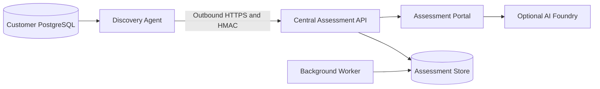
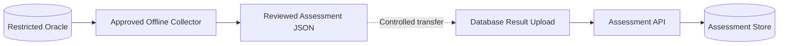
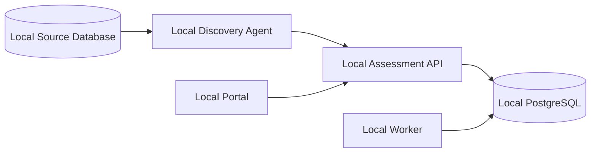

# Database Migration Assessment Toolkit Demo Guide

This guide provides a repeatable demonstration of the toolkit across all three project deployment modes: **Connected**, **Air-gapped**, and **Standalone**.

## Demo objective

Show how one assessment platform can support database discovery and migration planning across environments with different connectivity and security requirements.

The demonstration covers:

- Project and environment setup
- Database inventory
- Discovery Agent registration and assessment
- Baseline and engine-specific questionnaires
- Evidence upload and parsing
- Portfolio and dependency views
- Operational status
- Assessment findings and report readiness

## Important product note

Deployment mode is currently recorded as project metadata and displayed throughout the portal. It does not yet enforce network policy or automatically change available features.

During the demo, explain the operational pattern associated with each mode without claiming that selecting a mode configures firewalls, disables AI, or implements offline bundle transfer automatically.

## Scenario summary

| Mode | Demo project | Operating pattern | Primary workflow |
| --- | --- | --- | --- |
| Connected | Zava Connected Commerce Migration | Central portal with outbound Discovery Agent connectivity | Live agent discovery and continuous result upload |
| Air-gapped | Zava Product Innovation Assessment | Isolated source environment with controlled file transfer | Offline collection followed by manual evidence upload |
| Standalone | Zava Smart Factory Modernization | Portal, database, and Discovery Agent hosted together | Fully local assessment with no external platform dependency |

## Recommended duration

| Segment | Duration |
| --- | ---: |
| Introduction and dashboard | 3 minutes |
| Connected scenario | 8 minutes |
| Air-gapped scenario | 6 minutes |
| Standalone scenario | 6 minutes |
| Comparison and close | 2 minutes |

Total: approximately 25 minutes.

## Prerequisites

- Docker Desktop is running.
- .NET 8 SDK, Node.js 20 or later, and PowerShell 7 are installed if a rebuild is needed.
- The native database client is installed on the offline execution host (`sqlplus`, `psql`, `mysql`, `sqlcmd`, `mongosh`, `cqlsh`, or `isql`, as applicable).
- Ports `3000`, `5000`, and `5432` are available.
- The repository is open at `C:\github\DBMigrationReady`.
- A `.env` file exists with `POSTGRES_PASSWORD`, `APP_ADMIN_EMAIL`, and `APP_ADMIN_PASSWORD` set. Create it from `.env.example` for a new local environment.
- The presenter has the application administrator credentials. Do not display or include the password in demo materials.

Start the platform:

```powershell
cd C:\github\DBMigrationReady
docker compose up -d
```

Verify the API and portal:

```powershell
Invoke-RestMethod http://localhost:5000/health
Start-Process http://localhost:3000
```

The demo URLs are:

- Local portal: `http://localhost:3000`
- Local API: `http://localhost:5000`
- Local Swagger in Development mode: `http://localhost:5000/swagger`
- Azure portal: `https://ca-web-dbmigratio-dev-1fa1.whitetree-ce541b55.swedencentral.azurecontainerapps.io`

Use either the local or Azure portal for the demonstration. Sign in with the application administrator account before beginning the pre-demo setup. Portal authentication is managed by the application; Microsoft Entra sign-in is not required.

## Shared demonstration story

Zava, an intelligent athletic apparel company, is preparing database workloads for Azure across business units with different connectivity policies.

The assessment team must answer the same core questions:

1. What databases and dependencies are in scope?
2. Which database-specific migration blockers exist?
3. What evidence supports the findings?
4. Who owns remediation and sign-off?
5. How should workloads be grouped into migration waves?

The deployment mode changes how evidence reaches the portal, not the assessment outcome.

## Pre-demo setup

### Sign in

1. Open the selected portal URL.
2. Sign in with the configured application administrator email and password.
3. Confirm that the dashboard loads before creating or changing demo data.

The local administrator is seeded only when the application user table is empty. Changing `.env` later does not overwrite an existing user.

### Synchronize questionnaire templates

1. Open **Questionnaire**.
2. Select **Sync JSON templates** if the option is available.
3. Confirm that the active templates include:
   - Database Migration Baseline v3
   - Oracle Migration Assessment v3
   - PostgreSQL Migration Assessment v2
   - SQL Server Migration Assessment v2
   - MySQL Migration Assessment v2

### Create the demo customer and projects

Create one customer:

| Field | Value |
| --- | --- |
| Name | Zava |
| Industry | Intelligent athletic apparel |
| Region | Global |

Create three projects for that customer:

| Project | Mode | Description |
| --- | --- | --- |
| Zava Connected Commerce Migration | Connected | Live PostgreSQL and Oracle assessment for commerce and athlete services using outbound Discovery Agents connected to the central portal. |
| Zava Product Innovation Assessment | Air-Gapped | Restricted product R&D Oracle estate assessed through approved offline collection and controlled evidence transfer. |
| Zava Smart Factory Modernization | Standalone | Customer-hosted assessment workspace running locally beside intelligent apparel manufacturing systems. |

### Optional clean demonstration environment

For a completely fresh dataset, remove Docker volumes before starting. This deletes all local portal data and should only be used when existing data is disposable.

```powershell
docker compose down -v
docker compose up -d postgres api worker frontend
```

## Scenario 1: Connected

### Customer situation

Zava operates PostgreSQL and Oracle databases for digital commerce, athlete profiles, and connected apparel services in a network that permits outbound HTTPS to the centrally hosted assessment portal. No inbound access to the customer network is allowed.

### Architecture



### Configure the project

1. Open **Projects** and select **Zava Connected Commerce Migration**.
2. Confirm the mode badge is **Connected**.
3. Add environments:

| Name | Type | Location | Connectivity zone |
| --- | --- | --- | --- |
| Zava Commerce Production | PROD | London Datacenter | Customer Network |
| Azure Migration Landing Zone | UAT | UK South | Azure Private Network |

4. Add database inventory records:

| Name | Engine | Version | Host | Port | Criticality | Owner |
| --- | --- | --- | --- | ---: | --- | --- |
| commerce-orders-prod | PostgreSQL | 15.6 | postgres | 5432 | Critical | Digital Commerce Team |
| athlete-profile-oracle | Oracle | 19c | ora-athlete.internal | 1521 | High | Athlete Experience DBA Team |

### Demonstrate live discovery

For the strongest demo, use the included PostgreSQL end-to-end test. It creates an isolated project and runs a real Discovery Agent against the toolkit PostgreSQL container:

```powershell
.\tests\AgentPostgresE2E.ps1
```

Expected result:

```text
PASS: PostgreSQL agent assessment completed and persisted.
```

Alternatively, demonstrate registration manually:

1. Open **Discovery Agents**.
2. Select the Connected project.
3. Register `Zava-Commerce-Discovery-01` with the `postgresql` and `oracle` plugins.
4. Explain that the generated PSK is shown once and requests are signed with HMAC-SHA256.
5. Show that the Discovery Agent requires only outbound access to the API.
6. Dispatch a PostgreSQL assessment using an inventory database.
7. Open the job history and expand its findings.

### Demonstrate the connected workflow

1. Open **DB Inventory** and show engine, version, owner, and criticality.
2. Open **Questionnaire** and start the Database Migration Baseline.
3. Show required-field validation, attachments, draft saving, and template versioning.
4. Start the appropriate supplemental engine questionnaire.
5. Open **Discovery Agents** and show heartbeat, job status, and findings.
6. Open **Communication Map** to discuss application and database dependencies.
7. Open **Portfolio** and group the databases into discovery, pilot, and production waves.
8. Open **Reports** and explain that discovered facts, questionnaire decisions, and uploaded evidence form the report inputs.

### Connected scenario message

> Connected mode provides the fastest feedback loop. Discovery Agents remain inside the customer network, make outbound signed requests, and continuously return assessment results to the central workspace.

## Scenario 2: Air-gapped

### Customer situation

Zava's product innovation environment contains proprietary smart-fabric designs, sensor research, and athlete-performance models. It does not permit any network route between the source environment and the assessment portal. Database metadata is collected with an approved offline process, reviewed inside the secure boundary, and transferred through Zava's controlled media process.

### Architecture



### Configure the project

1. Open **Projects** and select **Zava Product Innovation Assessment**.
2. Confirm the mode badge is **Air-Gapped**.
3. Add environments:

| Name | Type | Location | Connectivity zone |
| --- | --- | --- | --- |
| Product Innovation Zone | PROD | Zava Research Facility | Air-Gapped Zone A |
| Sanitized Assessment Zone | UAT | Zava Research Facility | Transfer Zone |

4. Add database inventory records:

| Name | Engine | Version | Host | Port | Criticality | Owner |
| --- | --- | --- | --- | ---: | --- | --- |
| smart-fabric-rnd-oracle | Oracle | 19c | rnd-db-host | 1521 | Critical | Product Innovation Data Team |
| athlete-models-oracle | Oracle | 12.2 | research-db-host-02 | 1521 | High | Sports Science Systems Team |

### Prepare the offline assessment

1. Open **DB Inventory** and filter to **Zava Product Innovation Assessment**.
2. Find `smart-fabric-rnd-oracle` and select **Download offline assessment script**.
3. Transfer the generated script to the simulated restricted environment.
4. Confirm that PowerShell 7, `sqlplus`, and a read-only assessment account are available.
5. Run the collector:

```powershell
pwsh ./collect-smart-fabric-rnd-oracle-assessment.ps1 `
    -Username assessment_reader `
    -OutputPath ./smart-fabric-rnd-oracle-result.json
```

Enter the database password only at the secure prompt. For Oracle, the password is sent to `sqlplus` through standard input and is not placed in the process arguments. The script clears credential variables when collection completes.

The generated JSON uses the `offline-2.0` collector contract. Each query is recorded as an independent section with a `success` or `failed` status, so a denied privileged view does not discard successful baseline findings.

For Oracle, point out these sections during the demo:

- `identity`, `capacity`, and `objects`
- `invalidObjects` and `wrappedCode`
- `unsupportedObjects`
- `lobSize`
- `dailyRedoGeneration`

Open the result in a text editor inside the simulated secure boundary and verify:

- `databaseId` matches the intended inventory database.
- `pluginId` is `oracle` and `pluginVersion` is `offline-2.0`.
- `findingJson.contractVersion` is `2.0`.
- The file contains metadata findings only, not application table rows.
- No password or connection secret appears in the file.

Use synthetic, sanitized supporting evidence only. Do not use real customer data.

Create a small CSV such as `demo-airgapped-inventory.csv`:

```csv
database,engine,version,size_gb,schemas,criticality,notes
smart-fabric-rnd-oracle,Oracle,19c,850,42,Critical,RAC and Data Guard detected
athlete-models-oracle,Oracle,12.2,320,18,High,Database links require review
```

Create a short text file such as `demo-airgapped-assessment.txt`:

```text
Offline assessment summary
- Source collection executed with a read-only account.
- No business data was exported.
- Wrapped PL/SQL packages require manual remediation.
- AWR evidence covers the monthly peak period.
- Network transfer is prohibited; evidence was approved for controlled export.
```

### Demonstrate the air-gapped workflow

1. Transfer `smart-fabric-rnd-oracle-result.json` through the simulated controlled-media process.
2. Open **DB Inventory**, locate `smart-fabric-rnd-oracle`, and select **Upload assessment result**.
3. Choose the JSON file and confirm that the portal reports it was linked to `smart-fabric-rnd-oracle`.
4. Explain that the API validates the embedded database ID, engine plugin, schema version, JSON format, and 10 MB file limit.
5. Open the resulting assessment and show the successful sections and any isolated failed sections.
6. Explain that a manually imported assessment is marked unverified until an assessor reviews it and that no Discovery Agent identity is assigned.
7. Open **Evidence** and select the Air-gapped project.
8. Upload the sanitized inventory CSV and assessment summary as supporting evidence.
9. Explain file hashing, source-type detection, parse status, and evidence traceability.
10. Open **Questionnaire** and start Database Migration Baseline v3.
11. Highlight the questions covering:
   - Assessment script security approval
   - Read-only metadata collection
   - Missing prerequisites and owners
   - Data residency and transfer restrictions
   - RACI and sign-off
12. Start Oracle Migration Assessment v3.
13. Highlight AWR or Statspack evidence, unsupported Oracle objects, offline migration, reconciliation, rollback, and licensing.
14. Show that no active Discovery Agent is required for offline result collection or upload.
15. Open **Portfolio** and place the databases into separate waves based on criticality and remediation effort.

For a PostgreSQL or MySQL variant, the generated collector also includes migration signals such as missing primary keys, problematic or JSON columns, partitions, non-InnoDB tables, special columns, authentication plugin counts, and buffer-pool occupancy.

### Be explicit about the current boundary

The product generates a database-bound collector and validates the returned result during upload. The offline result is not cryptographically signed, and the product does not enforce removable-media approval or independently verify that the collector was unchanged. Those controls remain part of the customer's operating and review process, which is why imported assessments remain unverified.

### Air-gapped scenario message

> Air-gapped mode preserves the same assessment model and governance trail while replacing live agent communication with reviewed, controlled evidence transfer.

## Scenario 3: Standalone

### Customer situation

Zava's smart factory team wants a self-contained assessment workspace for a proof of concept beside its intelligent apparel production systems. The portal, API, worker, PostgreSQL store, and Discovery Agent run together on a customer-controlled workstation or server.

### Architecture



### Configure the project

1. Open **Projects** and select **Zava Smart Factory Modernization**.
2. Confirm the mode badge is **Standalone**.
3. Add environments:

| Name | Type | Location | Connectivity zone |
| --- | --- | --- | --- |
| Smart Factory Production | PROD | Zava Manufacturing Site | Local Network |
| Migration Lab | DEV | Zava Manufacturing Site | Docker Network |

4. Add database inventory records:

| Name | Engine | Version | Host | Port | Criticality | Owner |
| --- | --- | --- | --- | ---: | --- | --- |
| apparel-production | PostgreSQL | 16 | postgres | 5432 | High | Smart Factory Technology |
| materials-warehouse | MySQL | 8.0 | mysql.local | 3306 | Medium | Supply Chain Applications |

### Demonstrate the standalone workflow

1. Open **System** and show API, database, worker, and AI Foundry status.
2. Explain that the core assessment workflow works when AI Foundry is not configured.
3. Open **Discovery Agents** and select the automatically provisioned `Platform Local Agent`.
4. Show that its identity is persisted in a private Docker volume and it reaches the API using `http://api:8080`.
5. Dispatch a local PostgreSQL assessment.
6. Open the findings and compare them with the inventory record.
7. Start the baseline and PostgreSQL questionnaires.
8. Upload a local evidence file.
9. Demonstrate the dashboard counts and recent project activity.

The Platform Local Agent starts with the default stack:

```powershell
docker compose up -d
```

Use `postgres` for the included PostgreSQL container or `host.docker.internal` for a database running on the Docker host. The separate `agent-dev` profile remains available for temporary E2E identities.

### Standalone scenario message

> Standalone mode packages the complete assessment workflow into a customer-controlled deployment. It is suitable for proofs of concept, smaller estates, and environments that do not require a shared central service.

## Comparison slide or closing view

Use this table to conclude the demo:

| Capability | Connected | Air-gapped | Standalone |
| --- | --- | --- | --- |
| Portal location | Central/shared | Separate from source zone | Customer-local |
| Discovery Agent communication | Live outbound HTTPS | No live connection | Local network or Docker network |
| Evidence transfer | Automatic result upload and manual files | Generated assessment JSON plus controlled manual transfer | Local automatic upload and manual files |
| Questionnaire workflow | Supported | Supported | Supported |
| AI Foundry | Optional, centrally configured | Typically disabled or separately approved | Optional; core workflow works without it |
| Best fit | Enterprise shared service | Restricted or classified networks | PoC, departmental, or self-contained use |

## Presenter checklist

Before presenting:

- [ ] All five local services are running when demonstrating Standalone mode: PostgreSQL, API, worker, frontend, and local agent.
- [ ] The selected local or Azure portal URL loads successfully.
- [ ] The application administrator can sign in successfully.
- [ ] System Status shows API, database, and worker as healthy or running.
- [ ] The v3 baseline and Oracle questionnaire templates are active.
- [ ] Three projects exist with the correct deployment modes.
- [ ] Each project has at least one environment and database record.
- [ ] The generated Air-gapped collector and a synthetic `offline-2.0` result are ready.
- [ ] The offline result is linked to the intended inventory database and contains no credentials.
- [ ] A Connected or Standalone Discovery Agent result is available.
- [ ] No real credentials, PSKs, customer names, or sensitive evidence are visible.
- [ ] AI Foundry is either tested or clearly described as optional and not configured.

## Suggested closing statement

> The toolkit keeps assessment decisions, technical findings, evidence, ownership, and migration-wave planning in one place. Connected mode optimizes automation, Air-gapped mode preserves controlled evidence handling, and Standalone mode provides a complete local workspace. All three use the same assessment and governance model.

## Troubleshooting

### Portal is unavailable

```powershell
docker compose ps
docker compose up -d
```

### Sign-in fails

Check:

- `APP_ADMIN_EMAIL` and `APP_ADMIN_PASSWORD` are present in `.env` for a new local database.
- The API and PostgreSQL services are healthy.
- The account already stored in the application database is being used. Startup configuration does not overwrite an existing user.
- Browser cookies are enabled for the portal.

### API is healthy but the UI is stale

The frontend image copies prebuilt output. Rebuild it from the current source:

```powershell
npm --prefix src/frontend run build
docker compose up -d --build frontend
```

### New questionnaire templates are missing

1. Sign in to the portal.
2. Open **Questionnaire**.
3. Select **Sync JSON templates**.
4. Confirm that the template list contains the expected active versions.

Do not call the seed endpoint as an anonymous REST request. Template synchronization requires both the authenticated application session and its antiforgery token.

### Discovery Agent does not connect

Check:

- Agent ID and PSK match the registration response.
- The backend URL is reachable from the Discovery Agent container.
- The requested plugin is in the agent's allowed plugin list.
- The database hostname resolves from the Discovery Agent network.
- The database account has the documented read-only permissions.

### Offline assessment result is rejected

Check:

- The result is uploaded from the same database row used to generate the collector.
- `databaseId`, `pluginId`, and `schemaVersion` were not edited.
- The file is valid JSON and smaller than 10 MB.
- The collector completed and wrote the final envelope rather than a partial console capture.

### An offline assessment section failed

This does not invalidate successful sections. Review the section error, confirm that the native client returned a nonzero exit code, and grant only the documented read-only catalog permission if the missing section is required. Run and upload a new result after approval.

### AI status is Not Configured

This is acceptable for the Standalone and Air-gapped demonstrations. Inventory, questionnaires, evidence, Discovery Agent collection, and portfolio workflows do not require AI Foundry.