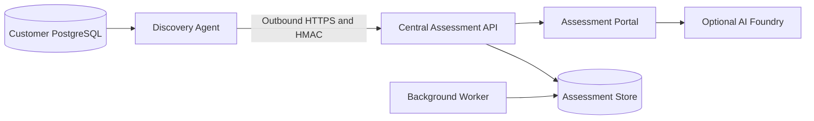
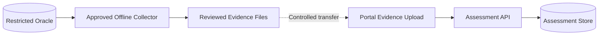
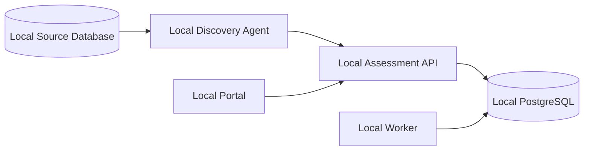

# Database Migration Assessment Toolkit Demo Guide

This guide provides a repeatable demonstration of the toolkit across all three project deployment modes: **Connected**, **Air-gapped**, and **Standalone**.

## Demo objective

Show how one assessment platform can support database discovery and migration planning across environments with different connectivity and security requirements.

The demonstration covers:

- Project and environment setup
- Database inventory
- Discovery Agent registration and assessment
- Baseline and engine-specific questionnaires
- Evidence upload and parsing
- Portfolio and dependency views
- Operational status
- Assessment findings and report readiness

## Important product note

Deployment mode is currently recorded as project metadata and displayed throughout the portal. It does not yet enforce network policy or automatically change available features.

During the demo, explain the operational pattern associated with each mode without claiming that selecting a mode configures firewalls, disables AI, or implements offline bundle transfer automatically.

## Scenario summary

| Mode | Demo project | Operating pattern | Primary workflow |
| --- | --- | --- | --- |
| Connected | Contoso Retail Cloud Migration | Central portal with outbound Discovery Agent connectivity | Live agent discovery and continuous result upload |
| Air-gapped | Fabrikam Defense Database Assessment | Isolated source environment with controlled file transfer | Offline collection followed by manual evidence upload |
| Standalone | Northwind Manufacturing Modernization | Portal, database, and Discovery Agent hosted together | Fully local assessment with no external platform dependency |

## Recommended duration

| Segment | Duration |
| --- | ---: |
| Introduction and dashboard | 3 minutes |
| Connected scenario | 8 minutes |
| Air-gapped scenario | 6 minutes |
| Standalone scenario | 6 minutes |
| Comparison and close | 2 minutes |

Total: approximately 25 minutes.

## Prerequisites

- Docker Desktop is running.
- .NET 8 SDK, Node.js 20 or later, and PowerShell 7 are installed if a rebuild is needed.
- Ports `3000`, `5000`, and `5432` are available.
- The repository is open at `C:\github\DBMigrationReady`.

Start the platform:

```powershell
cd C:\github\DBMigrationReady
docker compose up -d postgres api worker frontend
```

Verify the API and portal:

```powershell
Invoke-RestMethod http://localhost:5000/health
Start-Process http://localhost:3000
```

The demo URLs are:

- Portal: `http://localhost:3000`
- API: `http://localhost:5000`
- Swagger in Development mode: `http://localhost:5000/swagger`

## Shared demonstration story

Each customer is preparing database workloads for Azure but operates under a different connectivity policy.

The assessment team must answer the same core questions:

1. What databases and dependencies are in scope?
2. Which database-specific migration blockers exist?
3. What evidence supports the findings?
4. Who owns remediation and sign-off?
5. How should workloads be grouped into migration waves?

The deployment mode changes how evidence reaches the portal, not the assessment outcome.

## Pre-demo setup

### Synchronize questionnaire templates

1. Open **Questionnaire**.
2. Select **Sync JSON templates** if the option is available.
3. Confirm that the active templates include:
   - Database Migration Baseline v3
   - Oracle Migration Assessment v3
   - PostgreSQL Migration Assessment v2
   - SQL Server Migration Assessment v2
   - MySQL Migration Assessment v2

### Create the demo customer and projects

Create one customer:

| Field | Value |
| --- | --- |
| Name | Adventure Works Group |
| Industry | Retail and Manufacturing |
| Region | EMEA |

Create three projects for that customer:

| Project | Mode | Description |
| --- | --- | --- |
| Contoso Retail Cloud Migration | Connected | Live PostgreSQL and Oracle assessment using outbound Discovery Agents connected to the central portal. |
| Fabrikam Defense Database Assessment | Air-Gapped | Restricted Oracle estate assessed through approved offline collection and controlled evidence transfer. |
| Northwind Manufacturing Modernization | Standalone | Customer-hosted assessment workspace running locally beside the source database. |

### Optional clean demonstration environment

For a completely fresh dataset, remove Docker volumes before starting. This deletes all local portal data and should only be used when existing data is disposable.

```powershell
docker compose down -v
docker compose up -d postgres api worker frontend
```

## Scenario 1: Connected

### Customer situation

Contoso operates PostgreSQL and Oracle databases in a customer network that permits outbound HTTPS to the centrally hosted assessment portal. No inbound access to the customer network is allowed.

### Architecture



### Configure the project

1. Open **Projects** and select **Contoso Retail Cloud Migration**.
2. Confirm the mode badge is **Connected**.
3. Add environments:

| Name | Type | Location | Connectivity zone |
| --- | --- | --- | --- |
| Contoso Production | PROD | London Datacenter | Customer Network |
| Azure Migration Landing Zone | UAT | UK South | Azure Private Network |

4. Add database inventory records:

| Name | Engine | Version | Host | Port | Criticality | Owner |
| --- | --- | --- | --- | ---: | --- | --- |
| retail-orders-prod | PostgreSQL | 15.6 | postgres | 5432 | Critical | Retail Platform Team |
| loyalty-oracle-prod | Oracle | 19c | ora-retail.internal | 1521 | High | Loyalty DBA Team |

### Demonstrate live discovery

For the strongest demo, use the included PostgreSQL end-to-end test. It creates an isolated project and runs a real Discovery Agent against the toolkit PostgreSQL container:

```powershell
.\tests\AgentPostgresE2E.ps1
```

Expected result:

```text
PASS: PostgreSQL agent assessment completed and persisted.
```

Alternatively, demonstrate registration manually:

1. Open **Discovery Agents**.
2. Select the Connected project.
3. Register `Contoso-Prod-Discovery-01` with the `postgresql` and `oracle` plugins.
4. Explain that the generated PSK is shown once and requests are signed with HMAC-SHA256.
5. Show that the Discovery Agent requires only outbound access to the API.
6. Dispatch a PostgreSQL assessment using an inventory database.
7. Open the job history and expand its findings.

### Demonstrate the connected workflow

1. Open **DB Inventory** and show engine, version, owner, and criticality.
2. Open **Questionnaire** and start the Database Migration Baseline.
3. Show required-field validation, attachments, draft saving, and template versioning.
4. Start the appropriate supplemental engine questionnaire.
5. Open **Discovery Agents** and show heartbeat, job status, and findings.
6. Open **Communication Map** to discuss application and database dependencies.
7. Open **Portfolio** and group the databases into discovery, pilot, and production waves.
8. Open **Reports** and explain that discovered facts, questionnaire decisions, and uploaded evidence form the report inputs.

### Connected scenario message

> Connected mode provides the fastest feedback loop. Discovery Agents remain inside the customer network, make outbound signed requests, and continuously return assessment results to the central workspace.

## Scenario 2: Air-gapped

### Customer situation

Fabrikam does not permit any network route between the source environment and the assessment portal. Database metadata is collected with an approved offline process, reviewed inside the secure boundary, and transferred through the customer's controlled media process.

### Architecture



### Configure the project

1. Open **Projects** and select **Fabrikam Defense Database Assessment**.
2. Confirm the mode badge is **Air-Gapped**.
3. Add environments:

| Name | Type | Location | Connectivity zone |
| --- | --- | --- | --- |
| Secure Production Zone | PROD | Customer Secure Facility | Air-Gapped Zone A |
| Sanitized Assessment Zone | UAT | Customer Secure Facility | Transfer Zone |

4. Add database inventory records:

| Name | Engine | Version | Host | Port | Criticality | Owner |
| --- | --- | --- | --- | ---: | --- | --- |
| mission-planning-oracle | Oracle | 19c | classified-host | 1521 | Critical | Secure Database Operations |
| logistics-oracle | Oracle | 12.2 | classified-host-02 | 1521 | High | Logistics Systems Team |

### Prepare safe demonstration evidence

Use synthetic, sanitized files only. Do not use real customer data.

Create a small CSV such as `demo-airgapped-inventory.csv`:

```csv
database,engine,version,size_gb,schemas,criticality,notes
mission-planning-oracle,Oracle,19c,850,42,Critical,RAC and Data Guard detected
logistics-oracle,Oracle,12.2,320,18,High,Database links require review
```

Create a short text file such as `demo-airgapped-assessment.txt`:

```text
Offline assessment summary
- Source collection executed with a read-only account.
- No business data was exported.
- Wrapped PL/SQL packages require manual remediation.
- AWR evidence covers the monthly peak period.
- Network transfer is prohibited; evidence was approved for controlled export.
```

### Demonstrate the air-gapped workflow

1. Open **Evidence** and select the Air-gapped project.
2. Upload the sanitized inventory CSV and assessment summary.
3. Explain file hashing, source-type detection, parse status, and evidence traceability.
4. Open **Questionnaire** and start Database Migration Baseline v3.
5. Highlight the questions covering:
   - Assessment script security approval
   - Read-only metadata collection
   - Missing prerequisites and owners
   - Data residency and transfer restrictions
   - RACI and sign-off
6. Start Oracle Migration Assessment v3.
7. Highlight AWR or Statspack evidence, unsupported Oracle objects, offline migration, reconciliation, rollback, and licensing.
8. Show that no active Discovery Agent is required for the manual evidence workflow.
9. Open **Portfolio** and place the databases into separate waves based on criticality and remediation effort.

### Be explicit about the current boundary

The current product supports manual evidence upload for Air-gapped projects. It does not yet provide a signed offline export/import bundle command or enforce removable-media approval policy. Those controls remain part of the customer's operating process.

### Air-gapped scenario message

> Air-gapped mode preserves the same assessment model and governance trail while replacing live agent communication with reviewed, controlled evidence transfer.

## Scenario 3: Standalone

### Customer situation

Northwind wants a self-contained assessment workspace for a proof of concept. The portal, API, worker, PostgreSQL store, and Discovery Agent run together on a customer-controlled workstation or server.

### Architecture



### Configure the project

1. Open **Projects** and select **Northwind Manufacturing Modernization**.
2. Confirm the mode badge is **Standalone**.
3. Add environments:

| Name | Type | Location | Connectivity zone |
| --- | --- | --- | --- |
| Local Factory Production | PROD | Customer Site | Local Network |
| Migration Lab | DEV | Customer Site | Docker Network |

4. Add database inventory records:

| Name | Engine | Version | Host | Port | Criticality | Owner |
| --- | --- | --- | --- | ---: | --- | --- |
| factory-operations | PostgreSQL | 16 | postgres | 5432 | High | Manufacturing IT |
| warehouse-mysql | MySQL | 8.0 | mysql.local | 3306 | Medium | Warehouse Applications |

### Demonstrate the standalone workflow

1. Open **System** and show API, database, worker, and AI Foundry status.
2. Explain that the core assessment workflow works when AI Foundry is not configured.
3. Open **Discovery Agents** and register `Northwind-Local-Discovery`.
4. Show the local Docker deployment pattern using `http://api:8080` inside the Compose network.
5. Dispatch a local PostgreSQL assessment.
6. Open the findings and compare them with the inventory record.
7. Start the baseline and PostgreSQL questionnaires.
8. Upload a local evidence file.
9. Demonstrate the dashboard counts and recent project activity.

The local Discovery Agent pattern is:

```powershell
docker compose --profile agent up -d
```

The `agent-dev` configuration requires a valid registered agent ID and PSK. Do not commit bootstrap secrets to the repository.

### Standalone scenario message

> Standalone mode packages the complete assessment workflow into a customer-controlled deployment. It is suitable for proofs of concept, smaller estates, and environments that do not require a shared central service.

## Comparison slide or closing view

Use this table to conclude the demo:

| Capability | Connected | Air-gapped | Standalone |
| --- | --- | --- | --- |
| Portal location | Central/shared | Separate from source zone | Customer-local |
| Discovery Agent communication | Live outbound HTTPS | No live connection | Local network or Docker network |
| Evidence transfer | Automatic result upload and manual files | Controlled manual file transfer | Local automatic upload and manual files |
| Questionnaire workflow | Supported | Supported | Supported |
| AI Foundry | Optional, centrally configured | Typically disabled or separately approved | Optional; core workflow works without it |
| Best fit | Enterprise shared service | Restricted or classified networks | PoC, departmental, or self-contained use |

## Presenter checklist

Before presenting:

- [ ] All four core containers are running.
- [ ] `http://localhost:3000` loads successfully.
- [ ] System Status shows API, database, and worker as healthy or running.
- [ ] The v3 baseline and Oracle questionnaire templates are active.
- [ ] Three projects exist with the correct deployment modes.
- [ ] Each project has at least one environment and database record.
- [ ] Synthetic Air-gapped evidence files are ready.
- [ ] A Connected or Standalone Discovery Agent result is available.
- [ ] No real credentials, PSKs, customer names, or sensitive evidence are visible.
- [ ] AI Foundry is either tested or clearly described as optional and not configured.

## Suggested closing statement

> The toolkit keeps assessment decisions, technical findings, evidence, ownership, and migration-wave planning in one place. Connected mode optimizes automation, Air-gapped mode preserves controlled evidence handling, and Standalone mode provides a complete local workspace. All three use the same assessment and governance model.

## Troubleshooting

### Portal is unavailable

```powershell
docker compose ps
docker compose up -d postgres api worker frontend
```

### API is healthy but the UI is stale

The frontend image copies prebuilt output. Rebuild it from the current source:

```powershell
npm --prefix src/frontend run build
docker compose up -d --build frontend
```

### New questionnaire templates are missing

```powershell
Invoke-RestMethod -Method Post `
  -Uri http://localhost:5000/api/questionnaires/templates/seed
```

### Discovery Agent does not connect

Check:

- Agent ID and PSK match the registration response.
- The backend URL is reachable from the Discovery Agent container.
- The requested plugin is in the agent's allowed plugin list.
- The database hostname resolves from the Discovery Agent network.
- The database account has the documented read-only permissions.

### AI status is Not Configured

This is acceptable for the Standalone and Air-gapped demonstrations. Inventory, questionnaires, evidence, Discovery Agent collection, and portfolio workflows do not require AI Foundry.