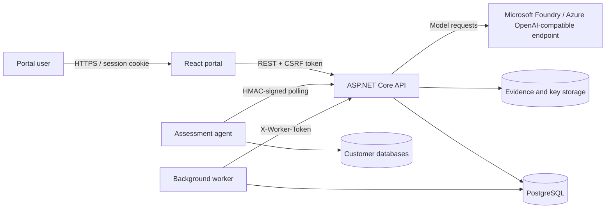

# Architecture and Security

**Reviewed:** 2026-09-02

## Runtime architecture

The frontend never connects directly to PostgreSQL or customer databases. Connected agents initiate outbound calls to the API, so the platform does not require inbound connectivity to an agent host.

## Component responsibilities

### Portal

- Hosts the authenticated application shell and twelve product routes.
- Uses React Query for server state and Axios for API calls.
- Obtains a CSRF token from the API and sends it on mutating requests.
- Generates report JSON downloads in the browser.

### API

- Owns application sessions, authorization, antiforgery validation and governance logging.
- Runs EF Core migrations at startup.
- Provisions the configured administrator and platform-local agent/project.
- Stores domain state in PostgreSQL and evidence files under the configured storage root.
- Orchestrates model connectivity checks, enrichment and persisted report generation.

### Worker

- Checks database connectivity and logs queue/agent counts every five minutes.
- Detects stale agent heartbeats.
- Times out overdue assessment jobs.
- Calls the API to enrich eligible assessment results.

### Assessment agent

- Loads bootstrap identity and locally held database connection details.
- Polls for assigned jobs.
- Resolves credentials locally, from inventory-linked data supplied with a job, or from ad hoc job input.
- Executes the selected plugin and submits structured findings.

## Authentication boundaries

### Portal users

- Application-managed credentials are stored as ASP.NET Core Identity password hashes.
- Successful login creates the `AssessmentToolkit.Session` HTTP-only cookie.
- The cookie uses `SameSite=Strict`, follows the request's secure policy and expires after eight hours with sliding renewal.
- The API returns `401` and `403` for unauthenticated and forbidden API calls rather than browser redirects.
- All endpoints require authentication by fallback policy except the health check, antiforgery bootstrap, login and agent-facing routes.

Microsoft Entra federation is not part of the current authentication path.

### Antiforgery

- Non-GET `/api` requests require the `X-CSRF-TOKEN` header.
- Agent-facing `/api/agent/*` requests are excluded because they use HMAC authentication.
- Authenticated service calls are excluded because they use the worker service identity.

### Agents

- Each agent has an ID and pre-shared key.
- Requests under `/api/agent/*` are signed with HMAC-SHA256 over request attributes and a body hash.
- The middleware enforces a timestamp freshness window and performs constant-time signature comparison.
- Stored agent records contain a salted hash, not a recoverable PSK.
- Raw bootstrap material must be handled as a secret and is shown/provisioned only where required for agent startup.

The middleware authenticates the agent ID from `X-Agent-Id` and requires it to match the `{agentId}` route value before database lookup or request processing. The implementation does not maintain a nonce cache, so it does not provide one-time replay rejection inside the accepted timestamp window.

For manually registered agents, the API stores the raw PSK only in its in-memory configuration. The persisted salted hash cannot be used by the current verifier after an API restart. The platform-local agent is reprovisioned through its bootstrap flow, but manual agents require explicit PSK configuration or re-registration. Durable self-service key rotation is not implemented.

### Worker

- The worker sends `X-Worker-Token` on API calls.
- The API compares the configured token in constant time and creates a restricted service identity.
- The service identity is intended for result enrichment and does not replace user or agent authentication.

## Authorization model

### Platform roles

| Role | Scope |
|---|---|
| `Administrator` | Platform-wide visibility and administration. |
| `User` | Project access through memberships, plus any authenticated endpoints that lack a stricter role check. |
| `Service` | Internal worker identity with a narrow API purpose. |

### Project memberships

| Role | Intended access |
|---|---|
| `Viewer` | Read project and environment-scoped information. |
| `Contributor` | Perform permitted project mutations. |
| `Owner` | Contributor access plus membership administration, report approval and permanent project deletion. |

Memberships may be project-wide or restricted to an environment. `GovernanceMiddleware`, controller filters and `ProjectAccessService` enforce many project/environment paths. This is not a universal object-level authorization boundary. Scope resolution is incomplete for questionnaire responses and graph edges; multipart evidence/import requests are not body-scoped by the middleware; and some global or creation endpoints, including customer/project creation, AI enrichment, system status/configuration/agents and AI provider/configuration APIs, lack membership-derived or administrator-only checks. The current portal does not provide membership administration UI.

## Governance and report integrity

- `GovernanceMiddleware` records successful non-authentication requests whose HTTP method is not GET, HEAD or OPTIONS as `AuditEvent` rows.
- Events include actor, action, resource, HTTP method, project context and occurrence time where available.
- Report generation snapshots source evidence into an `EvidenceBundle`.
- Each bundle stores the source JSON and a content hash.
- The API loads Markdown report instructions for every generation request and records the effective content, source and SHA-256 hash in the evidence bundle.
- Administrator saves use the previously read hash as an optimistic-concurrency token; host-managed read-only policy remains supported.
- `GeneratedReport` records reference their evidence bundle and retain reviewer/approver identities and timestamps through controlled state transitions.

Audit records are application-managed. GET endpoints are not audited even when they mutate state; agent job polling, for example, assigns a pending job during `GET /api/agent/{agentId}/jobs/next`. Append-only or tamper-evident behavior is not enforced by PostgreSQL permissions, triggers or an external immutable store.

## Persistence model

| PostgreSQL schema | Implemented records |
|---|---|
| `core` | Customers, projects, environments, AI providers, system configuration, application users and project memberships. |
| `inventory` | Database instances and JSON metadata. |
| `assessment` | Agents, jobs, results and uploaded evidence metadata. |
| `questionnaire` | Templates, sections, questions, responses and answers. |
| `graph` | Database-to-database edges and portfolios. |
| `reporting` | Evidence bundles and generated reports. |
| `audit` | Successful-write audit events. |

EF Core migrations are applied automatically by the API during startup. File content is stored separately from PostgreSQL under `Evidence:StorageRoot`.

Project deletion is an explicit owner/administrator operation. Restrict-linked questionnaire responses and generated reports are removed transactionally before the project aggregate so the remaining project-owned records can cascade safely. Evidence files are removed from `Evidence:StorageRoot` after the database transaction commits; a filesystem cleanup failure is logged and does not restore the deleted database records. Parent customers and independent audit events are retained.

## Secret and file handling

- Local Compose receives PostgreSQL, administrator and worker secrets from `.env`.
- Data Protection keys are persisted when `DataProtection:KeysPath` is configured.
- The local agent's `databases.json` contains plaintext database credentials and must be protected with host filesystem permissions.
- Report instructions are mounted as an external Markdown file. Write access enables the administrator editor; read-only mounts keep policy under operator control.
- Azure Bicep declares Key Vault, managed identity, role assignments and Azure Files mounts.
- `configureSecrets` must be enabled with valid secure parameters for a functional secret-backed Azure deployment.

Do not commit `.env`, bootstrap packages, `databases.json`, passwords, PSKs, service tokens or model credentials.

## AI data boundary

When reporting or enrichment is used, bounded evidence content is sent to the configured Microsoft Foundry/Azure OpenAI-compatible model endpoint. The complete evidence snapshot remains persisted locally as a hashed bundle. Operators are responsible for confirming that the chosen model deployment and data handling policy are approved for the assessed customer data.